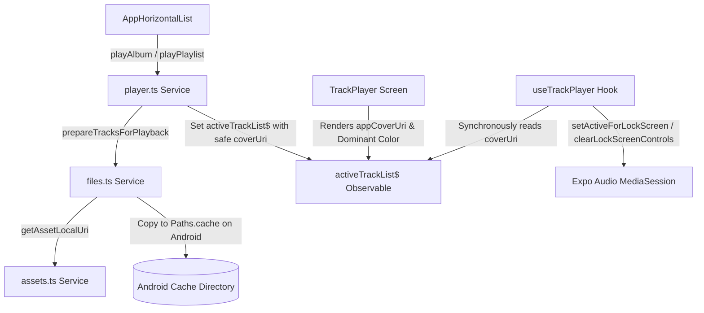

# Requirements

### Overview & Goals
Refactor the audio player artwork pipeline to eliminate timing issues, missing lock screen controls, and artwork loss on Android. By moving artwork resolution and Android cache preparation out of `useTrackPlayer.ts` and into the playback initialization step (`playAlbum` / `playPlaylist`), lock screen metadata becomes immediately available and synchronous when playback starts.

### Scope
- **In Scope:**
  - Asset file resolution functions in `src/services/assets.ts`.
  - Android cache copying and safe lock screen URI preparation in `src/services/player/files.ts`.
  - Pre-populating `coverUri` with safe lock screen file URIs when creating `activeTrackList$` in `src/services/legend/local/player.ts`.
  - Updating `src/components/AppHorizontalList.tsx` to await track preparation before launching the player screen.
  - Simplifying `src/hooks/useTrackPlayer.ts` by removing transparent pixel workarounds, runtime file copying, and asynchronous artwork resolution state.
- **Out of Scope:**
  - Modifying `TrackPlayer.tsx` UI layout, dominant color extraction, or image rendering (UI continues using `appCoverUri`).
  - Changing remote streaming or external network audio sources.
  - Modifying `usePreviewPlayer.ts`.

### Functional Requirements
- **Safe Lock Screen URIs:** When an album or playlist is played, each track in `activeTrackList$` must have a safe `file://` URI in `coverUri` that Android `MediaSession` and lock screen controls can access from the cache area.
- **Preserved Display Cover:** The original cover reference (asset require ID or document URI) must remain intact in `appCoverUri` for in-app UI rendering and dominant color detection.
- **Fast Track Transitions:** Track changes in `useTrackPlayer` must synchronize lock screen metadata immediately without waiting for asynchronous asset downloads or file copying.
- **Clean Lock Screen Reset:** When no track is active, `playlist.clearLockScreenControls()` must be invoked cleanly without generating or writing transparent dummy image files to disk.
- **Crash Defense:** All calls to `setActiveForLockScreen`, `updateLockScreenMetadata`, and `clearLockScreenControls` must be wrapped in defensive error handling.

### Non-Functional Requirements
- **Maintainability:** Reduce `useTrackPlayer.ts` complexity from ~530 lines down to clean, readable hook logic focused strictly on audio playlist state.
- **Performance:** Avoid redundant file copy operations by memoizing safe URI resolutions across tracks that share the same album cover.
- **Modern SDK Standards:** Use the modern Expo SDK 58 `expo-file-system` API (`File`, `Paths`) instead of legacy file system functions.

# Technical Design

### Current Implementation
Currently, `useTrackPlayer.ts` performs heavy file system and asset resolution inside React lifecycle hooks while playback is already starting:
- It maintains `TRANSPARENT_PIXEL_PATH` and writes a 1x1 base64 transparent PNG to disk on mount.
- It triggers an async `loadArtwork` effect on every track change, downloading asset modules and copying document files to the Android cache directory on the fly.
- Due to race conditions between playback startup, native `MediaSession` activation, and asynchronous artwork resolution, Android frequently loses artwork metadata and lock screen media options.

### Key Decisions
1. **Upfront Safe URI Preparation:**
   - Resolve safe artwork URIs during `activeTrackList$` creation in `playAlbum` and `playPlaylist`.
   - Store the safe lock screen URI in `MusicFile.coverUri` (as `string | null`).
   - Leave `MusicFile.appCoverUri` untouched for the UI.
2. **Dedicated Module Responsibilities:**
   - Asset resolution (`Asset.fromModule`, `downloadAsync`, local URI extraction) lives in `src/services/assets.ts`.
   - Android cache copying and safe lock screen URI preparation live in `src/services/player/files.ts` using modern `File` and `Paths` from `expo-file-system`.
   - `useTrackPlayer.ts` acts purely as an audio state controller with synchronous metadata passing.
3. **Memoized Batch Preparation:**
   - Since an entire album (or many playlist tracks) share the same artwork, `prepareTracksForPlayback` will memoize resolved URIs by `appCoverUri` during list creation.
4. **No Transparent Dummy Pixel:**
   - Expo Audio 58 provides `playlist.clearLockScreenControls()`, rendering the transparent pixel workaround obsolete.

### Proposed Changes

#### 1. `src/services/assets.ts`
- Add `getAssetLocalUri(assetModule: string | number): Promise<string | undefined>`:
  - Resolves asset via `Asset.fromModule`.
  - Awaits `asset.downloadAsync()`.
  - Returns `asset.localUri || asset.uri` formatted as `file://`.
- Add `getFallbackArtworkAssetUri(): Promise<string | undefined>`:
  - Resolves `IMAGES.cover200.notFound` to a local file URI.

#### 2. `src/services/player/files.ts`
- Add `prepareLockScreenArtworkUri(rawCoverUri: string | number | null | undefined): Promise<string | null>`:
  - If null/undefined: resolve fallback asset and ensure cached on Android.
  - If number (bundled asset): resolve asset local URI via `getAssetLocalUri` and copy to `Paths.cache` on Android if not already present.
  - If string (document URI or HTTP URL):
    - On Android: copy from document directory to `Paths.cache` (`artwork_cache_doc_<name>.png`) if not already present.
    - On iOS/Web: ensure standard `file://` / URL formatting.
  - Returns `file://` cache URI or URL string.
- Add `prepareTracksForPlayback(tracks: MusicFile[]): Promise<MusicFile[]>`:
  - Resolves safe `coverUri` for each track using an internal map cache to avoid duplicate disk copies for identical `appCoverUri` values.
  - Returns updated `MusicFile[]` with safe `coverUri` and original `appCoverUri`.

#### 3. `src/services/legend/local/player.ts`
- Update `playPlaylist` and `playAlbum` to be `async`:
  - Fetch and sort target tracks from `musicFiles$`.
  - Await `prepareTracksForPlayback(tracks)`.
  - Set `activeTrackList$` with prepared tracks and reset `activeTrackIndex$` to 0.

#### 4. `src/components/AppHorizontalList.tsx`
- In `handlePress`, make the handler `async` and `await` `playPlaylist(item.id)` / `playAlbum(item.id)` before calling `router.push('/(main)/(global)/TrackPlayer')`.

#### 5. `src/hooks/useTrackPlayer.ts`
- Delete `TRANSPARENT_PIXEL_PATH`, `resolveArtworkUri`, `prepareAndroidArtworkFile`, `prepareAndroidLocalFile`, and `getFallbackArtworkUri`.
- Remove `resolvedArtworkUrl` state and the `loadArtwork` `useEffect`.
- In the lock screen synchronization effect:
  - If `!currentTrack`: call `playlist.clearLockScreenControls()`.
  - If `currentTrack`:
    - Synchronously read `artworkUrl = typeof currentTrack.coverUri === 'string' ? currentTrack.coverUri : undefined`.
    - Construct `AudioMetadata` and `AudioLockScreenOptions`.
    - Call `playlist.setActiveForLockScreen(true, metadata, lockScreenOptions)` in a `try/catch` block.

### Architecture Diagram


### Data Models / Contracts
```typescript
// Field usage contract in MusicFile
export interface MusicFile {
  id: string
  audioUri: string
  // Safe lock screen file URI (file://... in cache on Android) populated in activeTrackList$
  coverUri: string | null
  // Original user-selected cover (asset number, document URI, or null) used by UI
  appCoverUri: string | number | null
  title: string
  artist: string | null
  album: string | null
  // ... other metadata fields unchanged
}
```

### Risks & Mitigations
- **Asynchronous Playback Initiation:** `playAlbum` and `playPlaylist` become asynchronous.
  - *Mitigation:* Because cover resolution is memoized per unique artwork, preparing an album takes just a few milliseconds. Awaiting before `router.push` guarantees `activeTrackList$` is fully populated before the player screen mounts.
- **Missing or Corrupt Cover Files:** A local document cover might have been moved or deleted.
  - *Mitigation:* `prepareLockScreenArtworkUri` safely catches file errors and falls back to `IMAGES.cover200.notFound` cached in the app cache area.

# Testing

### Validation Approach
Verification focuses on confirming that:
1. `activeTrackList$` contains safe `file://` cache URIs in `coverUri` while retaining original references in `appCoverUri`.
2. `useTrackPlayer` sets lock screen controls immediately without transient pixel fallbacks or missing artwork glitches.
3. No regressions occur when switching albums, playlists, or individual tracks.

### Key Scenarios
- **Play Album with Bundled Asset Cover:**
  - Trigger `playAlbum` with an album using bundled `IMAGES.cover600` asset.
  - Verify asset is resolved, cached to `Paths.cache` on Android, and `currentTrack.coverUri` points to the valid cache file.
  - Verify lock screen metadata displays title, artist, and artwork.
- **Play Playlist with Document Cover Images:**
  - Trigger `playPlaylist` containing tracks with custom covers from `Paths.document`.
  - Verify document covers are copied to `Paths.cache` on Android and accessible to the lock screen.
- **Track Navigation (Next / Previous / Skip):**
  - Skip between tracks in `TrackPlayer`.
  - Verify lock screen metadata updates synchronously without flickering or losing options.
- **Empty Track / End of Playlist:**
  - Dismiss player or reach end of playlist.
  - Verify `clearLockScreenControls` clears the lock screen controls without crashing.

### Edge Cases
- **Missing Artwork on Track:** Track with `appCoverUri: null` falls back gracefully to cached `IMAGES.cover200.notFound`.
- **Fast Skipping:** Rapidly skipping tracks does not trigger unhandled promise rejections or race conditions since artwork metadata is already synchronous.
- **Android Cache Eviction:** If Android cleans the cache directory, subsequent playlist/album playback calls re-verify and re-cache artwork files as needed.

# Delivery Steps

### ✓ Step 1: Implement asset and file cache helper services for safe lock screen artwork URIs
Artwork files and bundled assets are safely resolved to local file URIs and cached in the Android cache directory prior to playback.

- Implement `getAssetLocalUri` and `getFallbackArtworkAssetUri` in `src/services/assets.ts` to asynchronously download and retrieve local `file://` URIs for bundled Expo assets (including fallback artwork `IMAGES.cover200.notFound`).
- Implement `prepareLockScreenArtworkUri` in `src/services/player/files.ts` using modern `expo-file-system` (`File`, `Paths`) to convert raw asset or document URIs into safe lock screen file URIs (copying document/asset files to `Paths.cache` on Android when needed).
- Implement `prepareTracksForPlayback` in `src/services/player/files.ts` to batch-resolve artwork URIs for track arrays with memoization per unique `appCoverUri` to eliminate duplicate I/O operations.

### ✓ Step 2: Integrate safe artwork URI preparation into playlist and album playback initialization
Active playback track lists are populated with pre-resolved safe lock screen artwork URIs stored in `coverUri`.

- Update `playAlbum` and `playPlaylist` in `src/services/legend/local/player.ts` to be async functions that pass tracks through `prepareTracksForPlayback`.
- Ensure each `MusicFile` in `activeTrackList$` contains the safe local file URI in `coverUri` while preserving the user-facing image in `appCoverUri`.
- Update `handlePress` in `src/components/AppHorizontalList.tsx` to `await` the async `playPlaylist` and `playAlbum` calls before navigating to `/(main)/(global)/TrackPlayer`.

### ✓ Step 3: Refactor and simplify useTrackPlayer hook for synchronous lock screen controls
The track player hook is streamlined by removing runtime artwork resolution, transparent pixel generation, and race conditions.

- Remove legacy `FileSystemLegacy` dependencies, `TRANSPARENT_PIXEL_PATH` generation, and all runtime `resolveArtworkUri` logic from `src/hooks/useTrackPlayer.ts`.
- Replace asynchronous artwork state with direct synchronous consumption of `currentTrack.coverUri` for lock screen metadata.
- Configure `playlist.setActiveForLockScreen` and `playlist.clearLockScreenControls` calls wrapped in defensive `try/catch` blocks to prevent crashes.
- Verify playback, skipping, and lock screen metadata synchronization across album and playlist transitions.